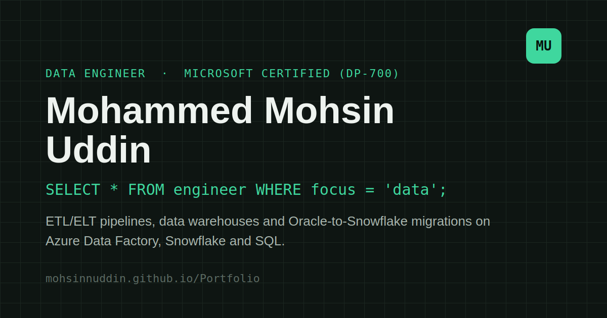

# Mohammed Mohsin Uddin

### Data Engineer · Azure Data Factory · Snowflake · SQL · Python

I build reliable data pipelines, transform complex source data into analytics-ready models, and automate database migration and validation workflows. I am a **Microsoft Certified Fabric Data Engineer Associate (DP-700)** with 1.5+ years of production data engineering experience.

<p align="left">
  <a href="https://mohsinnuddin.github.io/Portfolio/">Portfolio Website</a> ·
  <a href="https://www.linkedin.com/in/mohammed-mohsin-uddin-7830a9315/">LinkedIn</a> ·
  <a href="https://github.com/Mohsinnuddin">GitHub</a> ·
  <a href="assets/Resume.pdf">Download Resume</a>
</p>



---

## About Me

I am a Data Engineer I at **Aykitech IT Solutions** in Hyderabad, India. My work focuses on building and maintaining ETL/ELT pipelines, developing dimensional data warehouses, modernising SQL workloads, and improving data quality through automation.

I work across **Azure Data Factory, Azure SQL, Microsoft Fabric, Snowflake, Oracle SQL, SQL Server, Python, and dbt**. I also build automated validation and end-to-end tests to help ensure that data transformations and application workflows behave as expected.

## Professional Highlights

### Azure Data Factory and Data Warehousing
- Developed event-triggered pipelines that ingest CSV and Excel files from Azure Blob Storage into SQL staging tables.
- Integrated REST APIs and transformed nested JSON structures into relational data.
- Built modular stored procedures for filtering, deduplication, and data type standardisation.
- Orchestrated daily loads into fact and dimension tables using a star-schema design.

### Oracle-to-Snowflake Modernisation
- Refactored legacy Oracle SQL into Snowflake SQL using modular CTEs and explicit joins.
- Verified **100% row-level and aggregate output parity** between the source and target implementations.
- Used Snowflake Query Profile to identify expensive execution steps and guide query optimisation.
- Created data validation tests and automated Streamlit application workflows using Python and Selenium WebDriver.

### Production Database Migration Automation
- Built a Python and `pyodbc` framework to automate SQL Server database migration from backups to a production environment.
- Restored backups to staging, exported tables to consistently named CSV files, and provisioned target schemas programmatically.
- Added reconciliation checks for row counts, column data types, and schema mappings to validate the load.

## Technical Skills

| Area | Technologies and concepts |
|---|---|
| **Cloud and data platforms** | Azure Data Factory (ADF), Azure Blob Storage, Azure SQL, Microsoft Fabric, Snowflake, SQL Server |
| **SQL and databases** | SQL, T-SQL, Snowflake SQL, Oracle SQL, MySQL, stored procedures, CTEs, query optimisation |
| **ETL/ELT and integration** | Data pipelines, event-based triggers, scheduled orchestration, REST API ingestion, JSON parsing and flattening, CSV/Excel automation, dbt |
| **Data warehousing** | Dimensional modelling, star schema, fact and dimension tables, staging layers, data migration and reconciliation |
| **Programming and automation** | Python, `pyodbc`, Selenium WebDriver, Java, C/C++ |
| **Quality and analytics** | Data validation, end-to-end testing, Power BI, DAX, KPI dashboards, Looker Studio, Excel |
| **Tools** | Git, GitHub, Linux |

## Selected Projects

### Tourism Management System
A Java Swing and MySQL application for managing travel-related records, including customer profiles, tour packages, hotel reservations, cancellations, and booking history.

**Tech:** Java · Java Swing · SQL · MySQL  
[View project on GitHub](https://github.com/Mohsinnuddin/Tourism-Management-System)

### Gym Trainer Application
An Android application using Firebase Authentication and a real-time NoSQL database to support workout plans, fitness metrics, and activity tracking.

**Tech:** Java · Android Studio · Firebase  
[View project on GitHub](https://github.com/Mohsinnuddin/Gym-Trainer-App)

## Certifications

- **Microsoft Certified: Fabric Data Engineer Associate (DP-700)** — [Verify credential](https://learn.microsoft.com/api/credentials/share/en-us/mohsinnuddin/64E8080F8AAC35F8?sharingId=95E449EA0CF8642B)
- **Data Analytics with Microsoft Power BI** — NASSCOM IT-ITeS Sector Skills Council, September–December 2024. [Verify certificate](https://inspiration-fun-7467.my.salesforce-sites.com/CDACcertificatePage2?id=a02Vy000008lWpXIAU)

## Education

**Bachelor of Technology (B.Tech), Computer Science and Engineering**  
CSI Wesley Institute of Technology and Sciences · Hyderabad, India · 2020–2024

## About This Portfolio

This is a lightweight, responsive static website built with plain HTML, CSS, and JavaScript. It has no framework or build step.

- Responsive layout and keyboard-visible focus states
- Light/dark theme toggle with the selected theme saved in browser storage
- Scroll-progress indicator, section navigation, and back-to-top control
- Downloadable resume and contact links
- Favicon and app icons, social sharing image, structured metadata, `robots.txt`, sitemap, web manifest, and custom `404.html`
- Reduced-motion support for visitors who prefer less animation

## Run Locally

**Requirements:** a browser and Python 3 (or any static file server). No dependencies need to be installed.

From the directory containing `index.html`, run:

```bash
python -m http.server 8000
```

Open [http://localhost:8000](http://localhost:8000) in your browser. Stop the server with `Ctrl+C` when you are finished.

## Deploy with GitHub Pages

1. Keep `index.html` in the repository root used by GitHub Pages.
2. Commit and push the site files to the branch configured for Pages (commonly `main` or `gh-pages`).
3. In the repository settings, confirm the GitHub Pages source points to the correct branch and folder.

The published portfolio URL is **https://mohsinnuddin.github.io/Portfolio/**.

If you move the site to a different domain, update the canonical URL, social metadata, structured data, `site.webmanifest`, `robots.txt`, and `sitemap.xml` as well.

## Contact

For data engineering opportunities or collaboration:

- **Email:** [mohsinnuddin@gmail.com](mailto:mohsinnuddin@gmail.com)
- **LinkedIn:** [mohammed-mohsin-uddin-7830a9315](https://www.linkedin.com/in/mohammed-mohsin-uddin-7830a9315/)
- **Portfolio:** [mohsinnuddin.github.io/Portfolio](https://mohsinnuddin.github.io/Portfolio/)

---

*Thanks for visiting my portfolio. Feel free to connect with me on LinkedIn.*
